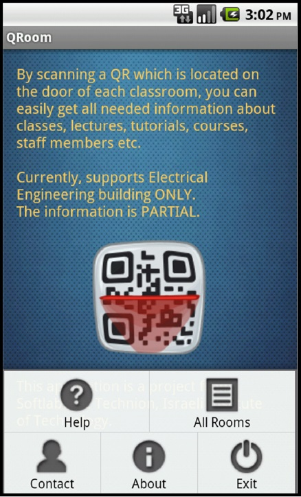

# QRoom: QR code applications on Android

<p align="center">
  
</p>

*Original project image, unchanged.*

QRoom was designed around QR codes on room entrances: an Android client read a code and retrieved room, class and lecturer information from a PHP/MySQL service.

Students: Tamir Buchris, Vitaly Kleynik. Supervision: Aaron Wetzler.


## Original

The recovered archive is partial: 81 files, of which 79 were imported unchanged and two are sanitized database configuration files. Required resources, scanner dependencies and database definitions are missing, so the Android app is incomplete. The [recovery notes](docs/RECOVERY.md) record historical requirements and attribution; see also [PROVENANCE.md](PROVENANCE.md).

> **Warning:** the recovered PHP backend has SQL-injection, authentication/CSRF and `eval` defects. Do not deploy it.

## Updated

[**Run the browser demo**](https://twerdster.github.io/android-qr-applications/)

A separate browser demo, written in November 2026, uses fictional room records stored in the page. You can inspect sample QR codes, look up a room from its payload, change the time of day to see its sample schedule and export the room data as JSON. The **Use this QR payload** button fills in the known QR text; the demo does not scan images or use the camera. It never loads or contacts the recovered backend.

### Run locally

```sh
python3 -m http.server 8000 --directory docs
```

Then open http://localhost:8000. No build step or external service is required.

### Checks and licensing

Browser-check results, implementation notes and limits are in [updated/README.md](updated/README.md). These checks apply only to the new demo; they do not validate the historical application or any hardware. The [MIT license](docs/DEMO-LICENSE.txt) covers only the new demo; original materials keep their existing attribution and terms.
