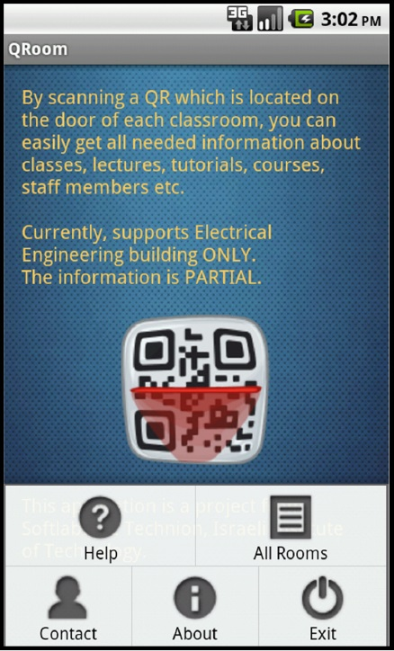

# Historical implementation and recovery notes

This record describes the recovered historical project and checks made before the separate browser example was added on 17 November 2026. Statements about unavailable software/builds refer to that historical application. See the [current README](../README.md) and [updated demo guide](../updated/README.md) for the new example.

# QR code applications on Android

  

An Android QR-code client and PHP/MySQL backend for campus room, schedule and lecturer information.

Students: Tamir Buchris, Vitaly Kleynik.

Supervision: Aaron Wetzler.

## Available source

QRoom was developed to retrieve campus room, class and lecturer information from QR codes placed at room entrances. The Android client extracts a room identifier from a scan, sends HTTP POST requests to PHP endpoints and parses JSON responses into room, course and staff records. The PHP content-management pages provide record-editing forms and a room selector that submits QR-code text to a PHP QR Code endpoint. That QR-code dependency is not included.

This is a partial historical submission. [`source/QRRooms/`](../source/QRRooms/) contains the student Android classes and configuration; [`source/CMS/`](../source/CMS/) contains content-management code; [`source/queries/`](../source/queries/) contains the query endpoints. Of the 81 included files, 79 retain their original bytes. The two database configuration files were sanitized as described below. There is no complete application or database release.

## Historical requirements

The Android project targets API 8 (Android 2.2) and uses the Eclipse/Ant-era toolchain, Java, Apache HttpClient and a repackaged ZXing scanner. The launcher is `technion.ee.softlab.qroom.QRoom.MainActivity`, and `qrRoomsApplication` stores the selected room. The backend uses MySQL and PHP's historical `mysql_*` API.

ZXing core/client code, PHP QR Code, Android resources/assets, generated output and APKs are omitted. No database/schema or personal campus records are included. Two additional duplicate legacy Java activities containing personal contact details were withheld; they are outside the 81-file import. Reports, signing keys, vendor code, VCS history and prebuilt executables are also excluded. Missing scanner classes, resources and database definitions prevent a complete build or deployment from this subset. No verified build command is available.

## Backend security and credential removal

**Do not deploy this archival backend or expose it to the internet.** A November 2026 static audit identified SQL injection, missing application-level authentication and CSRF checks, and execution of database-supplied content through `eval`. For example, `source/queries/get_room.php` concatenates request data into SQL, and `source/CMS/content.php` evaluates stored content. Credential removal does not address these defects. Any usable replacement needs a security redesign and independent review.

The two `source/{CMS,queries}/includes/constants.php` files are the only modified source files. Their private deployment values were replaced with `QROOM_DB_SERVER`, `QROOM_DB_USER`, `QROOM_DB_PASS` and `QROOM_DB_NAME` environment-variable lookups and explicit placeholder defaults. Raw originals remain private. Those placeholders are not a working or safe deployment configuration; do not commit real credentials.

Original Android URLs refer to an institutional service. That service was not contacted or validated during recovery and should not be treated as an available backend.

## Validation and limitations

A private recovery manifest (not published) distinguishes the 79 unchanged files from the two sanitized configurations. Source inspection shows the QR-result handling, HTTP/JSON exchange and the unsafe PHP query/evaluation paths. No Android build, PHP deployment, database migration or end-to-end scan was run. The screenshot is from the historical application; it is not evidence that this recovered subset can run.

## Links

- [Project entry on Aaron Wetzler's website](https://twerdster.github.io/#qr-code-applications-on-android)

## Attribution and reuse

Original student credits are preserved. No blanket software license has been added; third-party libraries must be obtained under their own terms. Original authors can open an issue to contribute updates or request corrections or removal of their material.

Vitaly Kleynik approved keeping the archival project page and repository on 12 November 2026; Tamir Buchris approved this on 15 November 2026. These are individual author responses, not a software license. See [author responses and preservation scope](../PROVENANCE.md). The backend security warning and partial-source limitations remain in effect.

Figure provenance: `assets/project-preview.jpg` is the original student-project app screenshot from the archived project page on Aaron Wetzler's website, copied without modification.
